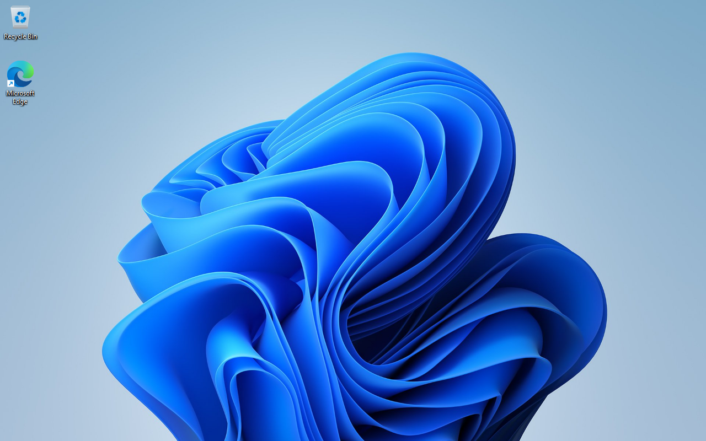
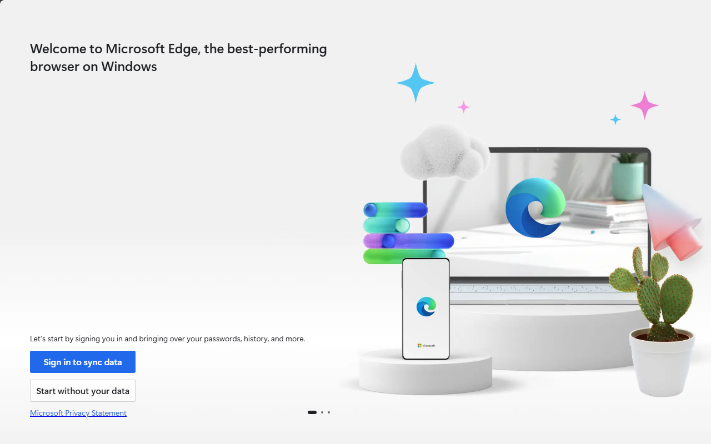

<h1 align="center">AntiMal</h1>

<p align="center"><b>A local workbench for Windows malware analysis.</b><br>
Observe a Windows guest, follow its behavior, and review the evidence in one place.</p>

<p align="center">
  
  
  
  <a href="#license"></a>
</p>

<p align="center">
  <a href="#get-started">Get started</a> ·
  <a href="#features">Features</a> ·
  <a href="#current-status">Current status</a> ·
  <a href="https://github.com/tbhtho/Anti-Mal/actions/workflows/ci.yml">Build and test workflow</a>
</p>

AntiMal combines an in-house Windows Hypervisor Platform VM, a live desktop console, process and event telemetry, and self-contained reports. It is a source preview for defensive research and local labs. **There is no packaged release.**

## Inside the guest

<table>
  <tr>
    <td width="50%"><a href="assets/screenshots/windows-guest-desktop.png"><br></a><sub><b>Windows desktop</b> - an earlier guest boot.</sub></td>
    <td width="50%"><a href="assets/screenshots/edge-in-guest-2026-06-17.png"><br></a><sub><b>Guest application</b> - Edge's welcome screen, June 17, 2026.</sub></td>
  </tr>
</table>

<sub>Genuine historical guest captures, with original pixels preserved. These are not screenshots of the AntiMal console and do not establish current boot reliability, containment or release acceptance. Select an image for full size.</sub>

## Features

- **Interactive VM.** An in-house WHP-based Windows guest with a live framebuffer, keyboard and mouse input, a separate viewer, and command-line controls for the same session.
- **Behavioral observation.** Process trees and command lines, file and registry activity, persistence, module loads, crashes, screenshots and network events, with attribution and coverage recorded alongside findings.
- **Evidence and reports.** JSON and self-contained HTML reports with timelines, filmstrips, MITRE ATT&CK tags and per-signal explanations. Compare runs, recover reports from retained journals, and export indicators as STIX 2.1, MISP, CSV or YARA.
- **Optional static enrichment.** File identity, PE inspection, scripts, documents and containers; strings, indicators and obfuscated configuration recovery; optional YARA, capa, Detect It Easy, MalwareBazaar and VirusTotal integration. Deep scanning is locked unless explicitly requested for that invocation.
- **Network inspection.** Packet capture and DNS/TLS-SNI extraction, with an opt-in emulated fake-internet sink. Networking starts disabled; contained networking still needs live validation for the selected guest configuration.
- **Operator tools.** A WebView2 desktop console, CLI and stdio MCP server, plus an optional policy-scoped assistant. Base-image checks, boot diagnostics, offline guest file/registry browsing and deliberate run finalization support repeatable investigations.

<details>
<summary>Static analysis capabilities</summary>

Static findings describe file contents, not observed VM behavior. Locked scans collect a streaming SHA-256 and bounded header identity, then report **Not run - locked** with an Unknown assessment. `scan <path> --unlock-static` is an explicit, invocation-scoped operator choice; it is not saved to configuration, and MCP/assistant tools do not expose an unlock operation.

When unlocked, the source includes:

- **Hashes and triage:** MD5, SHA-1, SHA-256, imphash, CTPH fuzzy similarity and Shannon entropy; file-type identification, extension/OriginalFilename mismatch checks and rule-based tags.
- **PE inspection:** imports and capability mapping, Authenticode status, sections and entropy, timestamps, overlays and embedded PE files, exports, VERSIONINFO, TLS callbacks, .NET/CLR, Rich headers and debug/PDB paths.
- **Scripts:** PowerShell, JScript, VBScript, batch, HTA and WSF indicators, including encoded commands, download cradles, LOLBins, AMSI-bypass patterns, hidden execution and character-code obfuscation. One-layer PowerShell EncodedCommand decoding can recover embedded endpoints.
- **Shortcuts:** `.lnk` command-line and target extraction, with suspicious launcher patterns.
- **Office and archives:** OLE/VBA and auto-execution indicators, embedded exploit objects, OOXML macro detection, executable payloads, double-extension lures and password-protected ZIP entries.
- **PDF and RTF:** JavaScript, auto-actions, launch commands, embedded files, RichMedia and PDF name decoding; RTF OLE objects, decoded embedded PE files, remote-object URLs and known Equation Editor carrier patterns.
- **ISO/IMG and OneNote:** ISO9660 shortcut/executable delivery patterns and OneNote embedded file, PE and script payload detection.
- **Strings and indicators:** ASCII/UTF-16 strings, URLs, IPs, domains, registry/file paths, mutex hints, base64 blobs and suspicious APIs. Configuration extraction includes single-byte and repeating-key XOR, base64-wrapped endpoints, RC4-wrapped configurations and Cobalt Strike beacon patterns.
- **External enrichment:** optional YARA rules, capa capabilities/MITRE techniques, Detect It Easy packer/protector results, and opt-in MalwareBazaar/VirusTotal hash lookups. Missing external analyzers are skipped; their availability must be considered when reading a result.
- **Hunting output:** recovered-configuration views, defanged indicators, generated YARA rules and report-to-report comparisons.

</details>

<details>
<summary>Dynamic analysis and VM capabilities</summary>

- **Process and event collection:** guest collectors stream through the COM2 host channel into `events.jsonl`. Process records include paths, command lines, integrity, user/session identity, start times and exit codes. Sensor coverage and losses limit what a run can establish.
- **Persistence:** Run, Winlogon, Services, IFEO, AppInit, ActiveSetup, Startup and COM-hijack families, with ATT&CK annotations.
- **Files, modules and crashes:** dropped-file hashes/type identification, module-load and injection-related indicators, and WER fault-module/exception decoding. A module load alone does not establish causality or complete injection coverage.
- **Live interaction:** shared-memory framebuffer delivery to the WebView2 canvas, PNG fallback, keyboard/mouse input, explicit text paste and Ctrl+Alt+Del. The VM worker is separate from the UI; process separation is not a containment guarantee.
- **Sample delivery:** framed COM2 delivery and a second read-only AHCI disk for larger packages. ISO mounting and installer selection happen inside the guest.
- **Network capture:** an emulated Intel 82574L/e1000e device and a local fake-internet responder for DHCP, ARP, ICMP, NTP, DNS, NBNS/LLMNR, TCP and HTTP. That responder has no real network egress. Packet capture records guest traffic and sink replies; TLS SNI reveals requested hostnames without decrypting TLS. This is not general internet access or a complete HTTPS responder.
- **VM foundation:** WHP vCPU/memory management, OVMF firmware, ACPI and interrupt/timer devices, TPM 2.0 CRB scaffolding, an in-house AHCI/SATA controller, legacy IDE support, VHDX/raw disks and copy-on-write overlays. Guest warm resets preserve the run overlay.
- **Display and diagnostics:** VGA/VBE/GOP framebuffer capture, serial output, boot-stage and frame-pacing diagnostics, crash/module discovery, PnP/resource inspection and offline base validation.
- **Run lifecycle:** bounded or until-stopped observation, deliberate finalization with guest-flush acknowledgment, retained overlays and journals, boot-reliability summaries and report recovery. Missing flush acknowledgment remains an artifact-durability limitation.
- **Console and automation:** editable configuration, in-app reports, confirmation before live execution, a minidump handler, JSON command output, configurable guest clock and sandbox-identifying device-string adjustments. The optional assistant uses an allow-listed VM tool surface, not a general host shell.

</details>

## Get started

Build from source on **Windows x64** with the **Visual Studio 2022 C++ toolchain (v143)**, **Windows SDK 10.0.26100.0** and MSBuild available in your developer terminal:

```powershell
msbuild AntiMal.sln /p:Configuration=Release /p:Platform=x64
bin\x64\Release\AntiMal.HostCli.exe init
bin\x64\Release\AntiMal.exe
```

The desktop console needs the Microsoft Edge WebView2 Runtime. A VM investigation additionally needs **Windows Hypervisor Platform**, [OVMF firmware](firmware/README.md) and a separately prepared Windows base image from your own licensed media. Windows installation media and a ready-to-run guest image are not provided. VirtualBox, VMware and Windows Sandbox are not supported providers.

Opening the console is not a completed VM setup. Validate the base and prove containment, input, observation, finalization and clean reset with harmless fixtures before investigating untrusted files.

<details>
<summary>Source setup, configuration and local checks</summary>

Outputs are written to `bin\x64\Release\`. The solution uses C++20 and the static Visual C++ runtime. Keep the built `webui`, loader, rules and tool files beside the executables as laid out by the projects.

Review [config/antimal.toml](config/antimal.toml) for the workspace and base-disk paths. **Base Setup** provides Build Base/Import Base controls; the corresponding source scripts are [New-AntiMalVmBase.ps1](tools/New-AntiMalVmBase.ps1) and [New-AntiMalBaseVhdx.ps1](tools/New-AntiMalBaseVhdx.ps1). Provisioning can require administrator rights. Preserve existing images instead of overwriting them for convenience.

Optional `yara.exe`, `capa.exe` and `diec.exe` are supplied separately. Threat-intelligence HTTP lookups are opt-in, and VirusTotal requires your own key. Keep keys and real credentials out of Git, reports and the guest. The optional assistant is disabled unless configured; its provider integration and live operation require separate validation.

Local developer checks:

```powershell
bin\x64\Release\AntiMal.Tests.exe
powershell -File tools\Smoke-AnalystWorkflow.ps1
```

The native suite and CLI smoke tests are distinct from live guest acceptance. WHP/firmware-dependent tests can skip when prerequisites or explicit opt-in are absent; a skip is not a pass. This presentation update does not claim a new application build or live VM test.

</details>

<details>
<summary>Useful operator commands</summary>

Run commands from `bin\x64\Release\`, or use the full executable path. These examples inspect readiness or existing evidence; they do not start a guest investigation.

```powershell
AntiMal.HostCli.exe doctor --json
AntiMal.HostCli.exe vmstatus --json
AntiMal.HostCli.exe report <run-id> --summary --json
AntiMal.HostCli.exe report <run-id> --why
AntiMal.HostCli.exe report <run-id> --html
AntiMal.HostCli.exe export <run-id> --format stix
AntiMal.HostCli.exe boot-report --json
```

During an explicitly authorized live run, `vmview`, `vmframe`, `vmmouse` and `vminput` operate the shared guest session. `vmfinalize <run-id> --wait` requests deliberate finalization; an emergency stop can lose evidence. `AntiMal.McpServer.exe` exposes the scoped stdio MCP tools.

`fs-ls`, `fs-cat`, `fs-find` and `reg-ls` inspect retained guest storage offline. Dirty registry hives may require recovery; a main hive without its transaction-log companions is not necessarily a current registry view. `simulate` creates synthetic report fixtures, not evidence of real execution.

</details>

## Current status

The source contains the console, analysis/reporting pipeline and in-house VM. Earlier supervised runs reached a Windows desktop and executed benign fixtures, but those observations are not a repeatable acceptance result for every base image or current build.

- **Still in progress:** reliable unattended boots, sustained guest typing, pointer behavior with acceleration/UAC, operator progress visibility and performance. Historical live display measurements included 14 FPS; a sustained 25-30 FPS target has not been established.
- **Evidence limits:** observation duration, offline networking, sensor gaps, queue/polling loss and incomplete attribution can leave an investigation inconclusive. File provenance and signature status are separate from malicious behavior.
- **Distribution:** no packaged GitHub release or repository-wide license is declared. Source access alone does not grant redistribution rights.

## Lab boundaries

**Do not execute or load untrusted files on the host.** Keep the source collection read-only, preserve base images and previous run disks, and use only synthetic credentials in the isolated guest. Do not expose host credentials, the host clipboard, writable shares or the LAN to samples.

Networking defaults to disabled. Guest execution requires all three gates: enabled configuration, per-run authorization and guest-side arming. Do not enable unrestricted public command-and-control traffic, upload samples or disable host security to make a run succeed.

Static enrichment is optional supporting evidence. A failed, locked or incomplete investigation must not become Clean; a quiet run or heuristic label is **not a safety certificate**. State what was observed, which process it belongs to, how long it was observed and what the sensors could not see.

## License

No repository-wide license is declared. Do not infer redistribution permission from source access. OVMF, WebView2 and other third-party materials retain their own terms; see [THIRD-PARTY-NOTICES.md](THIRD-PARTY-NOTICES.md).
